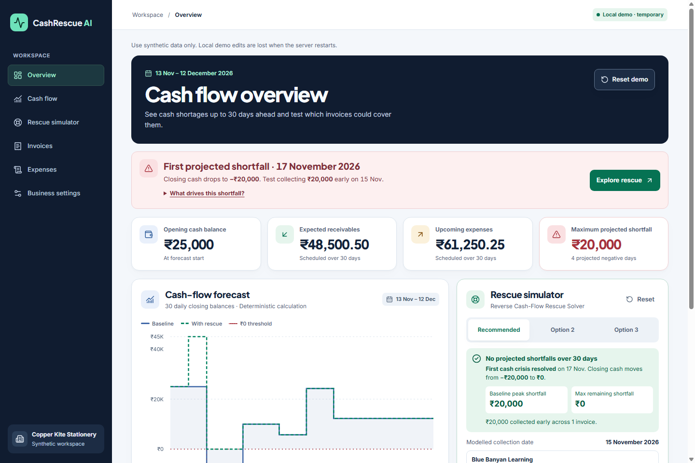
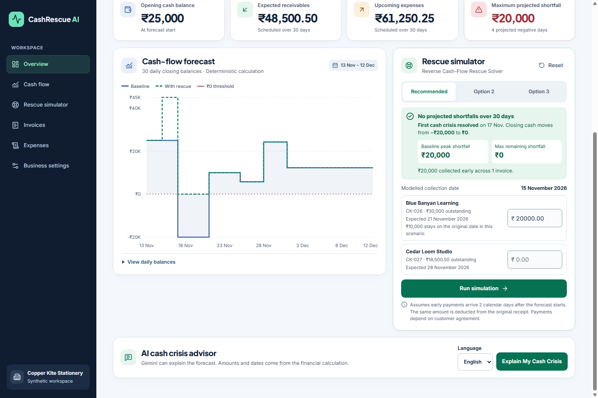
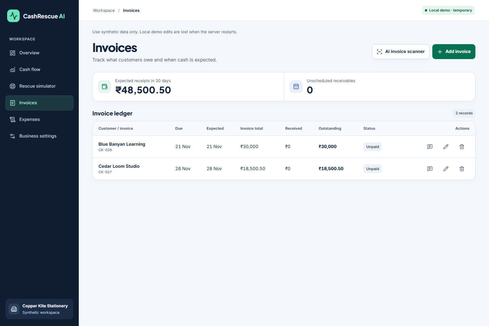
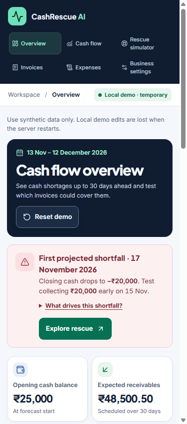

# CashRescue AI

**See a cash shortfall coming. Test which earlier invoice payments could close the gap.**

Finovators' solo entry for Arthaton 2026, AI for Finance. CashRescue AI models 30 days of cash flow for Indian small businesses and compares the baseline with hypothetical early collections.

[Demo script](docs/DEMO_SCRIPT.md) · [Judge Q&A](docs/JUDGE_QA.md) · [Design system](design-system/cashrescue-ai/MASTER.md) · [Deployment](docs/DEPLOYMENT.md)

## Problem and target users

A business can have enough outstanding invoices to cover payroll or rent and still run out of cash before customers pay. CashRescue AI is designed for owners and finance operators at small Indian businesses who track receivables, scheduled expenses, and opening cash.

## Key features

- A 30-day cash forecast with the first shortage date, projected closing balance, and maximum shortfall.
- An editable INR ledger for invoices, partial payments, and expenses.
- The Reverse Cash-Flow Rescue Solver recommends early collection amounts and compares daily balances across the full forecast.
- An independent public sandbox with fictional data, reset, and labeled explanation and reminder templates.
- Local Gemini invoice extraction with human review, English and Hindi explanations, and editable copy-only reminder drafts.

## Screenshots

Actual Phase 7.5 application screenshots from the production build running locally with the fictional Copper Kite Stationery ledger.

Rescue simulator, invoice management and mobile dashboard

## Reverse Cash-Flow Rescue Solver

The solver starts from days with a projected negative close and finds open, already-issued invoices whose receipt dates could move early enough to improve those days. It assumes early collection two calendar days after forecast start. It evaluates full and trimmed partial collections across subsets of up to ten ranked candidates, reruns the same forecast engine, and ranks improving scenarios across all 30 days. A partial collection moves only the selected amount. The remainder stays on the original expected date. A later shortfall remains visible in the chart and daily table.

Scenarios with no projected shortfalls rank first. For partial rescues, the solver prioritizes a smaller maximum remaining shortfall. The simulator reports the result on the first baseline crisis date separately from remaining shortfalls across the full period.

## Financial calculation methodology

All authoritative money values are safe integer INR paise. Dates use validated ISO calendar dates with Asia/Kolkata as the business time zone. Day one is the forecast start date. Each daily close adds expected receipts and subtracts scheduled expenses, so same-day cash flows are netted. An invoice uses its expected collection date or falls back to its due date. Overdue receivables without a usable future date are flagged and left unscheduled. Overdue scheduled expenses are included on day one. Paid and cancelled items are excluded from future movements. The lowest daily close below zero determines the maximum projected shortfall.

## Technology stack and architecture

The MERN stack uses MongoDB for optional local persistence, Express and Node.js for the API, and React for the workspace. Vite builds the client, Tailwind CSS styles it, and Recharts renders the forecast. Mongoose handles persistence, Zod validates data, and the Google GenAI SDK connects the server-side Gemini adapter. Vitest covers the engine and APIs.

~~~mermaid
flowchart LR
    B["React dashboard and per-tab demo ledger"] -->|"Same-origin API"| E["Express and Zod validation"]
    E --> P["Public sandbox: request-scoped ledger"]
    E --> L["Loopback ledger: memory or MongoDB"]
    P --> F["Integer-paise forecast and Rescue Solver"]
    L --> F
    P --> T["Labeled templates"]
    L --> G["Gemini: draft extraction and wording choices"]
    G -->|"User reviews and confirms invoice draft"| L
~~~

### AI architecture

Gemini extracts draft invoice fields from a PDF, PNG, or JPEG up to 5 MiB in local mode. The app validates the structured response, and the user confirms the invoice details and collection-date assumption before saving. For explanations and reminders, Gemini chooses approved wording options. The server inserts dates, figures, and transaction labels from the ledger and deterministic engine. Public mode returns labeled templates and leaves the provider disabled.

## Install and run

Use Node.js 22.12 or later and the bundled npm. Run these commands from the repository root.

~~~sh
npm ci
npm run dev
~~~

Open [the development dashboard](http://127.0.0.1:5174/). The default local ledger runs without MongoDB or Gemini. On Windows PowerShell use npm.cmd if the execution policy blocks npm.ps1.

### Environment configuration

| Variable | Use |
| --- | --- |
| NODE_ENV | Set to production when serving the built frontend. Startup requires the frontend build in this mode. |
| PUBLIC_DEMO | Set to true for the isolated public sandbox. |
| HOST and PORT | Defaults are 127.0.0.1 and 3001. Hosted public mode binds to 0.0.0.0 and uses the provider's PORT. |
| PUBLIC_ORIGIN | Optional exact origin for public mode behind managed ingress. Include the scheme and omit the trailing slash. |
| MONGODB_URI | Optional local persistence. Leave empty for the synthetic in-memory ledger. |
| GEMINI_API_KEY and GEMINI_MODEL | Optional server-side local AI configuration. Copy server/.env.example to server/.env and supply these locally. |
| API_PROXY_TARGET | Optional Vite development override if the local API changes port. |

See [Deployment](docs/DEPLOYMENT.md) for exact production settings and commands. Keep the hosted service free of local database and Gemini secrets.

### Tests and production build

~~~sh
npm test
npm run build
~~~

The 117 tests run without live Gemini or MongoDB. They cover forecast and money boundaries, scenario ranking and replay, ledger validation, public sandbox isolation, production behavior, and simulated Gemini responses. See [Final QA](docs/FINAL_QA.md) for the earlier browser and live Gemini checks.

## Try the synthetic demo

The default local app opens with the synthetic Copper Kite Stationery ledger. To try the per-tab sandbox, run the [production rehearsal commands](docs/DEPLOYMENT.md#production-rehearsal-on-loopback) and choose **Try Demo**. The seeded business projects a ₹20,000 shortfall on 17 November 2026. Choose **Explore rescue** to model receiving ₹20,000 on 15 November and compare the resulting ₹0 maximum shortfall with the baseline. Try a smaller amount, edit the fictional ledger, or reset the demo.

For local Gemini extraction, use the [fictional invoice PDF](output/pdf/synthetic-invoice.pdf) and follow the [timed walkthrough](docs/DEMO_SCRIPT.md).

## Security and privacy

Local editable modes bind to loopback. Public mode disables private ledger routes, uploads, MongoDB and live Gemini. Each tab keeps its ledger in memory, and the bounded sandbox API computes each request independently. No public ledger is persisted. Use fictional data because the app cannot determine whether a typed name is real. Browser API calls use the same origin, public computations are rate limited, and provider credentials belong only in the local server environment.

## Known limitations

The forecast models end-of-day cash for one business in INR. It does not estimate intraday liquidity or the probability that customers pay early. The bounded solver can miss feasible combinations. Public edits disappear on refresh, and live Gemini can time out or hit quota. The demo does not connect to banks, initiate payments, or send reminders. All reported impact is simulated.

## AI and open-source credits

Finovators used OpenAI Codex to assist with planning, implementation, tests, and documentation. Google Gemini powers the local AI features. The forecast and rescue logic are implemented and tested in this repository. Review the event's originality and disclosure rules before submission.

Open-source libraries include React, Vite, Express, Tailwind CSS, Recharts, Zod, Mongoose, Vitest and Lucide. The UI uses Inter and Plus Jakarta Sans through Fontsource. [Google GenAI SDK](https://github.com/googleapis/js-genai) · [Fontsource](https://fontsource.org/)

Finovators used the installed UI UX Pro Max v2.15.0 skill by Next Level Builder to research the Phase 7.5 redesign. The project-specific design system records the decisions adopted for CashRescue AI. The MIT-licensed skill and its companion packages are local design tools. [UI UX Pro Max v2.15.0](https://github.com/nextlevelbuilder/ui-ux-pro-max-skill/releases/tag/v2.15.0) · [Upstream MIT license](https://github.com/nextlevelbuilder/ui-ux-pro-max-skill/blob/v2.15.0/LICENSE)
